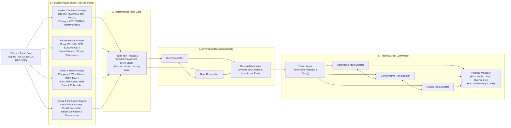

# TradingAgents — Self-Hosted Multi-Asset & Multi-Market AI Financial Engine

> **Upstream Attribution & Credit:**
> This repository is a customized, self-hosted engineering fork built upon the original open-source [**TradingAgents**](https://github.com/TauricResearch/TradingAgents) framework created by **Tauric Research** (*Yijia Xiao, Edward Sun, Di Luo, and Wei Wang* — [arXiv:2412.20138](https://arxiv.org/abs/2412.20138)).
> All credit for the foundational multi-agent trading graph architecture, researcher/risk debate topology, and core prompt design belongs to the original authors. The original [`LICENSE`](./LICENSE) (Apache 2.0) is preserved intact in the root of this repository.


---

## Overview

While the upstream **TradingAgents** project focuses primarily on US equity simulations via CLI, **`tradingagents-homelab`** extends the framework into a **production-ready, deterministic, multi-asset and multi-market financial analysis microservice** designed to operate as the AI brain for the [**Invest Portfolio**](https://github.com/JoseV-001/invest-portfolio) wealth consolidation platform.

It natively analyzes **Global Equities, Brazilian B3 Assets (`.SA`), Real Estate Funds (`FIIs` & `REITs`), ETFs, Cryptocurrencies (`24/7`), Forex pairs, Commodities/Futures, Macroeconomic Indicators (`FRED`), and Prediction Markets (`Polymarket`)** — enforcing strict anti-hallucination guardrails so agents never fabricate prices, dividends, or financial ratios.

---

## Multi-Asset & Multi-Market Coverage

The dataflow router (`tradingagents/dataflows/router.py`) and symbol resolution engine (`tradingagents/dataflows/symbols.py`) automatically classify and route instruments across global exchanges and asset classes:

| Asset Class / Market | Ticker Format & Examples | Regional Benchmark / Mode | Data Vendors & Specialized Handling |
| :--- | :--- | :--- | :--- |
| **US Equities, REITs & ETFs** (`NYSE` / `NASDAQ`) | `AAPL`, `MSFT`, `NVDA`, `O`, `VOO`, `SCHD`, `QQQ` | `SPY` (`S&P 500`) | **Yahoo Finance**, **Alpha Vantage**, **SEC EDGAR** (`10-K`/`10-Q` filings), **Finnhub**, **StockTwits**, **Reddit** |
| **Brazilian B3 Equities, Units, FIIs & ETFs** | `PETR4.SA`, `VALE3.SA`, `ITUB4.SA`, `HGLG11.SA`, `MXRF11.SA`, `IVVB11.SA` (bare tickers like `PETR4` or `WEGE3` auto-normalize to `.SA`) | `^BVSP` (`Ibovespa`) | **Brapi (`brapi.dev`)** primary deterministic connector (`summaryProfile`, `defaultKeyStatistics`, `financialData`, `cashDividends` filtered point-in-time) + **Yahoo Finance** fallback |
| **Global International Exchanges** | `.TO` (Toronto), `.L` (London), `.HK` (Hong Kong), `.T` (Tokyo), `.DE` (XETRA), `.PA` (Paris), `.AS` (Amsterdam), `.SW` (Swiss), `.MI` (Milan), `.AX` (Australia), `.SS`/`.SZ` (China), `.KS`/`.KQ` (Korea), `.TW` (Taiwan), `.NS`/`.BO` (India) | Auto-mapped regional index (`^FTSE`, `^GDAXI`, `^N225`, `^HSI`, `^BVSP`, etc.) | Automatic relative-alpha benchmark selection (`_infer_benchmark_ticker`) and multi-currency metadata extraction |
| **Cryptocurrencies (`24/7` Spot)** | `BTC-USD`, `ETH-USD`, `SOL-USD`, `ADA-USD`, `XRP-USD`, `DOGE-USD` (or `BTC/USD`, `BTCUSD`) | `BTC-USD` (`asset_type="crypto"`) | Dedicated **Crypto Mode**: 24/7 calendar awareness, market-cap & circulating-supply fundamentals (`get_crypto_metrics`), and crypto sentiment routing (`r/Bitcoin`, `r/CryptoCurrency`, `r/CryptoMarkets`) |
| **Forex Spot Pairs** | `EURUSD=X`, `GBPUSD=X`, `USDJPY=X`, `BRL=X` | Macro / FX Parity | **Yahoo Finance** (`=X` normalization) + **FRED** interest-rate differential & inflation series |
| **Commodities & Futures** | `GC=F` (Gold), `SI=F` (Silver), `CL=F` (WTI Crude), `NG=F` (Natural Gas) | Spot / Futures Curve | **Yahoo Finance** (`=F` contracts) + global macro news & **Polymarket** event probabilities |
| **Indices & CFDs** | `^GSPC`, `^NDX`, `^DJI`, `^BVSP`, `^VIX` | Index Level | Technical indicator suite (RSI, MACD, Bollinger Bands, ATR, VWMA, SMA/EMA) |

---

## Multi-Agent LangGraph Architecture

Every ticker analysis request executes a structured **multi-stage adversarial workflow** where specialized analysts gather empirical tool evidence before researchers, traders, and risk officers debate the investment thesis:



### Detailed Agent Responsibilities
1. **Market / Technical Analyst (`market_analyst.py`):** Pulls historical OHLCV data (`get_stock_data`) and computes deterministic indicators (`close_50_sma`, `close_200_sma`, `ema_10`, `rsi`, `macd`, `macds`, `macdh`, `boll`, `boll_ub`, `boll_lb`, `atr`, `vwma`) alongside regional benchmark alpha comparison (`^BVSP`, `SPY`, `^FTSE`, etc.).
2. **Fundamentals Analyst (`fundamentals_analyst.py`):**
   - For **Brazilian B3 (`.SA`)**: Queries **Brapi** (`tradingagents/dataflows/vendors/brapi.py`) for valuation multiples, balance sheet stats, margins, and historical cash dividends/JCP filtered strictly by `paymentDate <= trade_date`.
   - For **US Equities**: Queries **Yahoo Finance** / **Alpha Vantage** fundamentals plus **SEC EDGAR** (`get_sec_filing_sections`) for `10-K` and `10-Q` disclosures (`Item 1A Risk Factors`, `Item 7 MD&A`).
   - For **Cryptocurrencies**: Switches automatically to `get_crypto_metrics` (Market Cap, FDV, 24h Volume, Circulating/Max Supply, 52-week ranges, ATH/ATL distance).
3. **News & Macro Analyst (`news_analyst.py`):** Combines company-specific news (`get_news`), global headlines (`get_global_news`), **FRED** macroeconomic indicators (`get_macro_summary` — CPI, Unemployment, Fed Funds Rate, 10Y Treasury, 10Y-2Y Yield Curve Spread), and **Polymarket** prediction-market probabilities (`get_prediction_markets`).
4. **Social & Sentiment Analyst (`social_media_analyst.py`):** Aggregates **StockTwits** cashtag sentiment (`get_stocktwits_sentiment`), **Reddit** discussions (`get_reddit_company_social`, dynamically routing crypto tickers to `r/Bitcoin`, `r/CryptoCurrency`, `r/CryptoMarkets`), and corporate insider transactions (`get_insider_sentiment`, `get_insider_transactions`).
5. **Adversarial Researchers (`bull_researcher.py`, `bear_researcher.py`, `research_manager.py`):** Conduct multi-round bull vs. bear debates strictly constrained to metrics verified by the Analyst Team, culminating in the `Research Manager`'s synthesis.
6. **Trader & Risk Management Committee (`trader.py`, `aggressive_debator.py`, `conservative_debator.py`, `neutral_debator.py`, `risk_manager.py`):** The `Trader` formulates an execution proposal, which is stress-tested by three risk personas before the `Portfolio Manager` emits the final structured decision (`Buy`, `Overweight`, `Hold`, `Underweight`, or `Sell`).

---

## Anti-Hallucination & Data Integrity Engineering

A core engineering focus of this fork is **eliminating LLM financial hallucinations** when analyzing non-US tickers, illiquid FIIs/ETFs, or missing API fields:

1. **Pre-Analyst Verified Market Snapshot (`VERIFIED MARKET SNAPSHOT`):**
   Before the graph runs, `TradingAgentsGraph._build_verified_market_snapshot()` fetches the ground-truth latest close price, date, and 5-day price window from `route_to_vendor("get_stock_data", ...)` and injects it into the global state. No downstream agent is allowed to contradict this anchor price.
2. **Deterministic Tool-Output Audit (`_audit_tool_results` in `turn.py`):**
   Every tool call output is inspected for failure markers (`DATA_UNAVAILABLE`, `401 Unauthorized`, `403 Forbidden`, `429 Too Many Requests`, empty frames, or all-`N/A` payloads).
   - If **Market** or **Fundamentals** tools return no usable data, the analyst short-circuits deterministically with `Insufficient Data` (`DADOS INSUFICIENTES`) **without invoking the LLM to guess**.
   - If **News** or **Social** tools return empty results, the analyst emits a factual "no verified news/sentiment found" note and continues without fabricating headlines.
3. **Cross-Agent Evidence Guardrails (`STRICT_PRICE_AND_EVIDENCE_RULES`):**
   Injected across all debate nodes (`Bull`, `Bear`, `Research Manager`, `Trader`, `Risk Debaters`, and `Portfolio Manager`), explicitly forbidding agents from inventing P/E, P/VP, ROE, Dividend Yield, Debt/EBITDA, or macroeconomic numbers from pre-training memory.

---

## FastAPI Microservice (`api_server.py`)

In addition to the Python SDK and CLI, this repository exposes a lightweight **FastAPI** server on port `8000` for seamless integration with [**invest-portfolio**](https://github.com/JoseV-001/invest-portfolio):

| Method | Endpoint | Description |
| :--- | :--- | :--- |
| `GET` | `/health` (or `/`) | Healthcheck returning service status and active Gemini model (`gemini-3.1-flash-lite`). |
| `POST` | `/api/chat` | **Portfolio AI Copilot Chat:** Accepts user messages, conversation history, and a live `portfolio_context` JSON snapshot (positions across B3, NYSE/NASDAQ, and Crypto, FX rate, P&L, and allocation percentages) to answer portfolio-specific advisory questions in Brazilian Portuguese. |
| `POST` | `/api/analyze` | **Deep Multi-Agent Ticker Analysis:** Normalizes the requested ticker (automatically mapping B3 symbols like `PETR4`, `VALE3`, `HGLG11`, `IVVB11` to `.SA`), runs `TradingAgentsGraph.propagate()`, and returns the final decision plus individual Markdown reports for every agent stage. Supports `fast: true` (`market` + `fundamentals` fast-track) or full 4-analyst committee execution. |

---

## Quick Start & Installation

### 1. Clone and Set Up Virtual Environment
```bash
git clone https://github.com/JoseV-001/tradingagents-homelab.git
cd tradingagents-homelab
python3 -m venv .venv
source .venv/bin/activate
pip install -e .
```

### 2. Configure Environment Variables (`.env`)
Copy `.env.example` to `.env` and configure your keys:
```bash
cp .env.example .env
```

| Variable | Required | Description |
| :--- | :--- | :--- |
| `GOOGLE_API_KEY` | **Yes** (for Gemini default) | Google AI Studio API key used by `gemini-3.1-flash-lite`. |
| `BRAPI_TOKEN` | Recommended (for B3 `.SA`) | Token from [brapi.dev](https://brapi.dev) for Brazilian stocks, Units, FIIs, and ETFs. |
| `ALPHA_VANTAGE_API_KEY` | Optional | Fallback fundamental & news provider for US equities. |
| `FINNHUB_API_KEY` | Optional | Supplementary market and insider sentiment provider. |
| `FRED_API_KEY` | Optional | St. Louis Fed API key for live US macroeconomic series (`CPIAUCSL`, `FEDFUNDS`, `DGS10`, `T10Y2Y`). |
| `OPENAI_API_KEY` / `ANTHROPIC_API_KEY` | Optional | Only required if switching `llm_provider` away from `"google"`. |

### 3. Run the FastAPI Microservice
```bash
.venv/bin/uvicorn api_server:app --host 0.0.0.0 --port 8000
```

Test the endpoints:
```bash
# Healthcheck
curl http://localhost:8000/health

# Multi-Agent Analysis (B3 Equity, US Stock, or Crypto)
curl -X POST http://localhost:8000/api/analyze \
  -H "Content-Type: application/json" \
  -d '{"ticker": "WEGE3.SA", "fast": true}'
```

### 4. Run Quality Checks & Test Suite
```bash
.venv/bin/ruff check .
.venv/bin/pytest -q
```

---

## License & Citation

Licensed under the **Apache License 2.0** (see [`LICENSE`](./LICENSE)).

If you reference the underlying multi-agent trading research framework, please cite the original authors:
```bibtex
@misc{xiao2025tradingagentsmultiagentsllmfinancial,
      title={TradingAgents: Multi-Agents LLM Financial Trading Framework},
      author={Yijia Xiao and Edward Sun and Di Luo and Wei Wang},
      year={2025},
      eprint={2412.20138},
      archivePrefix={arXiv},
      primaryClass={q-fin.TR},
      url={https://arxiv.org/abs/2412.20138},
}
```
