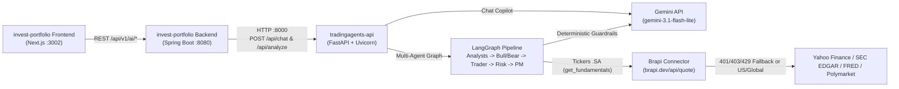

# TradingAgents Homelab Edition (B3 & Portfolio AI Copilot)

> **Upstream Attribution:** This repository is a customized, self-hosted extension built on top of the original open-source **[TradingAgents](https://github.com/TauricResearch/TradingAgents)** multi-agent trading framework by [Tauric Research](https://github.com/TauricResearch) (licensed under [Apache-2.0](LICENSE)). It adapts the upstream framework for low-memory homelab Docker deployments, Brazilian stock exchange (**B3**) fundamental data via **Brapi**, strict anti-hallucination guardrails, and REST integration with **[invest-portfolio](https://github.com/JoseV-001/invest-portfolio)**.

> ⚠️ *Research & portfolio engineering project only. Outputs are generated from available tool evidence and LLMs and do not constitute financial, investment, or trading advice.*

---

## Key Extensions Over Upstream

- **FastAPI REST Microservice (`api_server.py`):**
  Exposes a lightweight HTTP bridge on port `8000` powered by Google Gemini (`gemini-3.1-flash-lite` by default) with zero local LLM memory overhead:
  - `GET /health` & `GET /`: service readiness and active model check.
  - `POST /api/chat`: contextual personal portfolio financial copilot accepting real consolidated holdings (`portfolio_context`) and conversation `history`.
  - `POST /api/analyze`: asynchronous multi-agent orchestration (`TradingAgentsGraph.propagate`) supporting `fast` mode (`["market", "news", "fundamentals"]`) or full 4-analyst runs (`+ "social"`).

- **Deterministic B3 Brapi Connector (`tradingagents/dataflows/vendors/brapi.py`):**
  Native `.SA` ticker routing through `https://brapi.dev/api/quote/{ticker}?fundamental=true&dividends=true`:
  - Immediately short-circuits non-`.SA` symbols (`NoMarketDataError`, `0 ms`) so US/international tickers continue cleanly via `sec_edgar` / `yfinance`.
  - Strips `.SA` solely on the HTTP request while keeping canonical `.SA` identifiers across all reports.
  - Extracts **P/L**, **P/VP**, **ROE**, **Dividend Yield** (plus point-in-time `cashDividends` filtered by `approvedOn <= as_of_date`), **LPA**, **VPA**, **Net Profit Margin**, and **Recent Price Change**, marking any `null`/unavailable metric explicitly as `Insufficient Data`.
  - Gracefully converts `HTTP 401/402/403/429/5xx` responses to `VendorUnavailableError` so `router.py` seamlessly falls back to `yfinance`.

- **Deterministic Anti-Hallucination Guardrails (`tradingagents/agents/`):**
  - **Analysts (`market_analyst.py`, `sentiment_analyst.py`, `news_analyst.py`, `fundamentals_analyst.py`):** Python pre/post-turn evidence auditing (`_audit_tool_results`) that enforces deterministic `Insufficient Data` / `DATA_UNAVAILABLE` reports whenever tools return gaps, withholding placeholders, or empty payloads—forbidding the model from inventing headlines, dates, multiples, or holdings from training memory.
  - **Debate & Decision Nodes (`bull_researcher.py`, `bear_researcher.py`, `research_manager.py`, `trader.py`, `aggressive_debator.py`, `conservative_debator.py`, `neutral_debator.py`, `portfolio_manager.py`):** Unified `STRICT_PRICE_AND_EVIDENCE_RULES` and `build_evidence_coverage_summary` (`context.py`) requiring strict traceability to verified analyst outputs and banning fabricated support levels, resistance levels, price targets, or stop-losses.

- **Lightweight Homelab Containerization (`Dockerfile.api`, `docker-compose.yml`):**
  Packaged with a `512m` memory cap on the shared Docker network (`invest-portfolio_invest-net`) for direct container-to-container communication with `invest-portfolio` (Spring Boot + Next.js).

---

## Architecture Overview



---

## Environment Configuration

Copy `.env.example` to `.env` and set your API keys (never commit `.env` files):

| Variable | Required | Default | Description |
| :--- | :--- | :--- | :--- |
| `GOOGLE_API_KEY` | Yes (Gemini) | — | Google AI Studio / Gemini API key used by chat & multi-agent nodes. |
| `BRAPI_TOKEN` | Recommended (B3) | `""` | Brapi.dev bearer token for full B3 `.SA` coverage (falls back to `yfinance` when omitted/restricted). |
| `BRAPI_MIN_INTERVAL_MS` | No | `400` | Thread-safe minimum interval (ms) between concurrent Brapi requests. |
| `TRADINGAGENTS_LLM_PROVIDER` | No | `google` | Active LLM provider (`google`, `openai`, `anthropic`, etc.). |
| `TRADINGAGENTS_QUICK_THINK_LLM` | No | `gemini-3.1-flash-lite` | Fast model used for analysts, debaters, and `/api/chat`. |
| `TRADINGAGENTS_DEEP_THINK_LLM` | No | `gemini-3.1-flash-lite` | Reasoning model used for manager synthesis nodes. |
| `TRADINGAGENTS_OUTPUT_LANGUAGE` | No | `Portuguese` | Output report language while preserving machine-readable English rating labels. |
| `FRED_API_KEY` | No | — | Optional Federal Reserve Economic Data API key for US/Euro macro series. |

---

## Running With Docker Compose

Ensure the shared Docker network exists (created by `invest-portfolio`, or create it manually):

```bash
docker network create invest-portfolio_invest-net || true
cp .env.example .env
# Fill GOOGLE_API_KEY and BRAPI_TOKEN in .env
docker compose up -d --build
```

Verify service health:

```bash
curl http://localhost:8000/health
# {"status":"ok","model":"gemini-3.1-flash-lite"}
```

### Local Development & Test Suite

```bash
python -m venv .venv
source .venv/bin/activate
pip install -e ".[dev]"

ruff check .
pytest -q
```

---

## API Reference & Payload Examples

### `POST /api/chat` — Portfolio Financial Copilot

```bash
curl -X POST http://localhost:8000/api/chat \
  -H "Content-Type: application/json" \
  -d '{
    "message": "How is my USD vs B3 exposure balanced right now?",
    "history": [
      {"role": "user", "content": "Summarize my portfolio allocation."}
    ],
    "portfolio_context": {
      "totalGrossEquityBrl": 28894.10,
      "totalEquityB3Brl": 10044.50,
      "totalEquityNomadBrl": 18849.60,
      "currentUsdBrlRate": 5.50
    }
  }'
```

### `POST /api/analyze` — Multi-Agent Ticker Analysis

```bash
curl -X POST http://localhost:8000/api/analyze \
  -H "Content-Type: application/json" \
  -d '{
    "ticker": "PETR4.SA",
    "date": "2026-11-25",
    "analysts": ["market", "news", "fundamentals"],
    "fast": true
  }'
```

Returns `final_rating`, `final_trade_decision`, and structured section outputs (`market_report`, `sentiment_report`, `news_report`, `fundamentals_report`, `investment_plan`, `trader_investment_plan`, `bull_history`, `bear_history`, `risk_history`).

---

## Upstream CLI & Python Package Usage

All original CLI (`tradingagents`) and Python package APIs (`TradingAgentsGraph`, `run_backtest`, `DEFAULT_CONFIG`) from [TauricResearch/TradingAgents](https://github.com/TauricResearch/TradingAgents) remain available.

## License & Citation

Distributed under the [Apache License 2.0](LICENSE) from the upstream [TradingAgents](https://github.com/TauricResearch/TradingAgents) repository.

```bibtex
@misc{xiao2025tradingagentsmultiagentsllmfinancial,
      title={TradingAgents: Multi-Agents LLM Financial Trading Framework},
      author={Yijia Xiao and Edward Sun and Di Luo and Wei Wang},
      year={2025},
      eprint={2412.20138},
      archivePrefix={arXiv},
      primaryClass={q-fin.TR},
      url={https://arxiv.org/abs/2412.20138}
}
```
